 

**Web Developer** · India · Building for the web

[Portfolio projects](#selected-work) · [Tech stack](#tools-i-use) · [Connect](#lets-connect)

---

## About

I'm **Rajyavardhan Singh**, a web developer interested in building useful, responsive, and well-crafted web experiences.

I've worked on business websites and eCommerce stores, handling responsive layouts, theme customization, storefront improvements, and day-to-day website development. I enjoy the mix of visual problem-solving and writing code that makes a site work smoothly.

Currently, I'm strengthening my JavaScript fundamentals and working towards modern frontend and full-stack development.

- Building with HTML, CSS, JavaScript, WordPress, and Shopify
- Experience with Elementor, WooCommerce, and Shopify Liquid
- Learning JavaScript deeper, then moving into React
- Interested in frontend engineering and practical product development

## Selected Work

<table>
  <tr>
    <td width="100%">
      <h3>GutGlow</h3>
      
A product-focused website concept with a bold visual direction and a modern, scroll-led presentation.

      <a href="https://gutglow.co.in/"><strong>Visit live website ↗</strong></a>
        
      
      
    </td>
  </tr>
</table>

## Tools I Use

  

  
  
  
  

## Currently Learning

- JavaScript fundamentals, DOM manipulation, and browser events
- Building small projects to improve problem-solving
- Git and GitHub workflows
- React and modern frontend development (next)

## Let's Connect

  
  
  

  Keep building. Keep learning. Ship better things.

