  

  

## About me

I'm a web developer from India who enjoys building websites that are clean, responsive and easy to use.

I work with **WordPress** and **Shopify**, creating business websites, landing pages and eCommerce stores. I also customize themes and use HTML, CSS, JavaScript and Liquid to improve website functionality and design.

At the moment, I'm focused on getting stronger at JavaScript and growing into full-stack development.

## What I work with

  

**Platforms & tools:** Shopify · WooCommerce · Elementor · Liquid · Responsive Web Design

## Projects

I'm currently rebuilding my public project portfolio. New applications will be added here once they are complete, tested and documented.

## What I'm learning now

- JavaScript fundamentals and problem solving
- Building projects with modern frontend tools
- Backend development and full-stack concepts

## Find me

[GitHub](https://github.com/khalinaGamer) · [LinkedIn](https://www.linkedin.com/in/rajyavardhan-singh-240a4a22a/) · [Instagram](https://www.instagram.com/vardhan_r_a_j/)

---

  <i>Thanks for stopping by. I'm always learning and building something new.</i>

