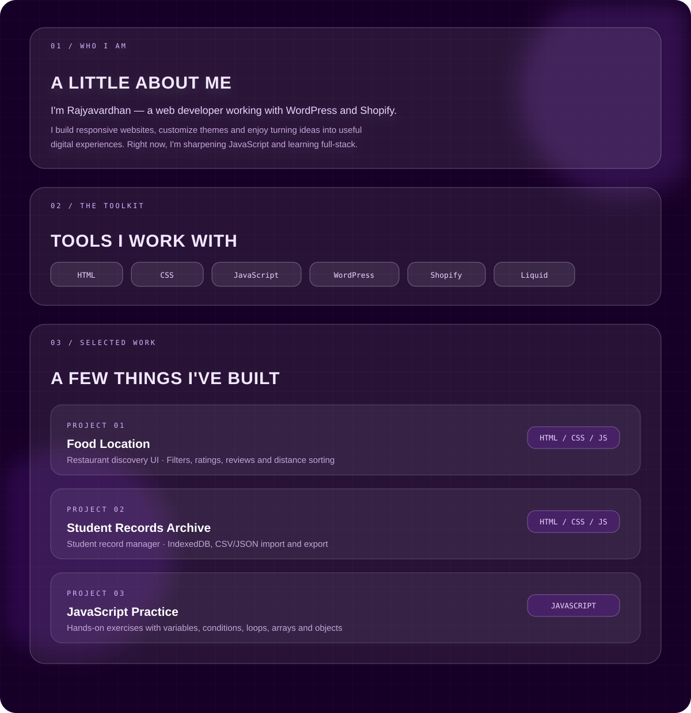

  

  
  
  

  

  **Project source:** [Food Location](https://github.com/khalinaGamer/school/blob/main/mobile.html) · [Student Records Archive](https://github.com/khalinaGamer/school/blob/main/site.html) · [JavaScript Practice](https://github.com/khalinaGamer/school)

  <a href="https://github.com/khalinaGamer?tab=repositories">Explore repositories</a>
  &nbsp;·&nbsp;
  <a href="https://github.com/khalinaGamer?tab=overview">GitHub activity</a>

  

<i>Curious by default. Building one project at a time.</i>

